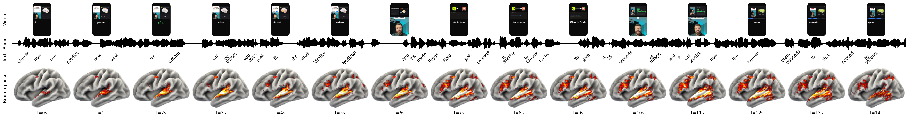

# 🧠 Neuro-Virality Predictor

[](https://colab.research.google.com/github/kethysb/neuro-virality-predictor/blob/main/notebooks/neuro_virality_predictor.ipynb)
[](https://opensource.org/licenses/MIT)
[](https://www.python.org/)
[](https://github.com/facebookresearch/tribev2)

> **Predict human cortical fMRI responses, second-by-second attention spikes, and retention curves for short-form video hooks using NeuroAI.**

---

## 🗺️ Visualização de Ativação Cortical (Resultado Real de 15s)

Abaixo está o resultado de inferência de um gancho de 15 segundos extraído de um Reel do Instagram, alinhando **vídeo frame a frame**, **onda acústica do áudio**, **transcrição fonética do Whisper** e o **mapa térmico 3D da superfície cerebral** (`fsaverage5`):



---

## 🔬 Como Funciona a Ciência por Trás?

Diferente de métricas superficiais de "visualizações" ou "likes", este pipeline prevê a **física e a biologia da atenção humana**:

1. **Quebra do Piloto Automático (DMN)**: Ao rolar o feed, o espectador está na *Default Mode Network* (devaneio mental / gasto mínimo de energia). Um gancho forte nos primeiros 3 segundos desativa a DMN e recruta a **Rede de Saliência**.
2. **Sinal BOLD (*Blood-Oxygen-Level Dependent*)**: O modelo **TRIBE v2** (treinado em centenas de horas de exames de ressonância magnética funcional com humanos assistindo a vídeos) prevê exatamente para onde o sangue oxigenado corre no cérebro a cada segundo.
3. **Pico no Giro Temporal Superior (STG)**: O ápice de atenção aos **00:03 - 00:04 segundos** (mancha incandescente amarela/branca) corresponde à decodificação semântica imediata da promessa do vídeo.

---

## 🏗️ Arquitetura Multimodal

O pipeline realiza a fusão de três modalidades sensoriais antes de projetar as respostas nos **20.484 vértices corticais**:

```
[ Vídeo (.mp4) ]
   ├── Áudio: Wav2Vec-BERT (Padrões acústicos e entonação)
   ├── Fala & Texto: WhisperX + LLaMA-3.2-3B (Embeddings contextuais palavra por palavra)
   └── Visão: V-JEPA 2 + DINOv2 (Estrutura espacial e dinâmica a 30 fps)
         │
         ▼
[ Fusão Multimodal TRIBE v2 ] ──► [ Preditor fMRI Cortical (fsaverage5) ]
                                          │
                                          ▼
                               [ Mapa 3D & Curva de Atenção ]
```

---

## 🚀 Como Executar em 1 Clique (Google Colab)

A forma mais rápida e prática de rodar em qualquer GPU T4 gratuita:

1. Clique no botão [](https://colab.research.google.com/github/kethysb/neuro-virality-predictor/blob/main/notebooks/neuro_virality_predictor.ipynb)
2. Faça o upload do seu vídeo de até 15–30 segundos no Colab (ex: `gancho_teste_15s.mp4`).
3. Execute todas as células (`Ambiente de Execução > Executar tudo`).
4. O notebook gera e baixa automaticamente o mapa de ativação 3D (`gancho_cerebro_3d_15s.png`).

---

## 💻 Execução Local / CLI

### 1. Clonar o repositório
```bash
git clone https://github.com/kethysb/neuro-virality-predictor.git
cd neuro-virality-predictor
```

### 2. Instalar dependências
```bash
pip install -r requirements.txt
pip install "tribev2[plotting] @ git+https://github.com/facebookresearch/tribev2.git"
```

### 3. Extrair os primeiros 15s de qualquer Reel / TikTok / Shorts
```bash
python src/extract_hook.py "https://www.instagram.com/reel/DechDEGCfcs/" "gancho.mp4" 15
```

---

## 🛠️ Tecnologias Utilizadas

* **[Meta TRIBE v2](https://github.com/facebookresearch/tribev2)**: Modelo mestre de NeuroAI para predição fMRI.
* **[Unsloth LLaMA 3.2 3B](https://huggingface.co/unsloth/Llama-3.2-3B)**: Extrator semântico de linguagem com bypass aberto.
* **[WhisperX](https://github.com/m-bain/whisperX)**: Alinhamento fonético temporal exato em nível de palavras.
* **[PyTorch](https://pytorch.org/) & [Nilearn](https://nilearn.github.io/)**: Processamento de tensores neurais e malhas neuroanatômicas 3D.

---

## 📄 Licença

Distribuído sob a licença **MIT**. Consulte o arquivo [LICENSE](LICENSE) para mais detalhes.

Feito com 🧠 por [Kethely Soriano](https://github.com/kethysb).
